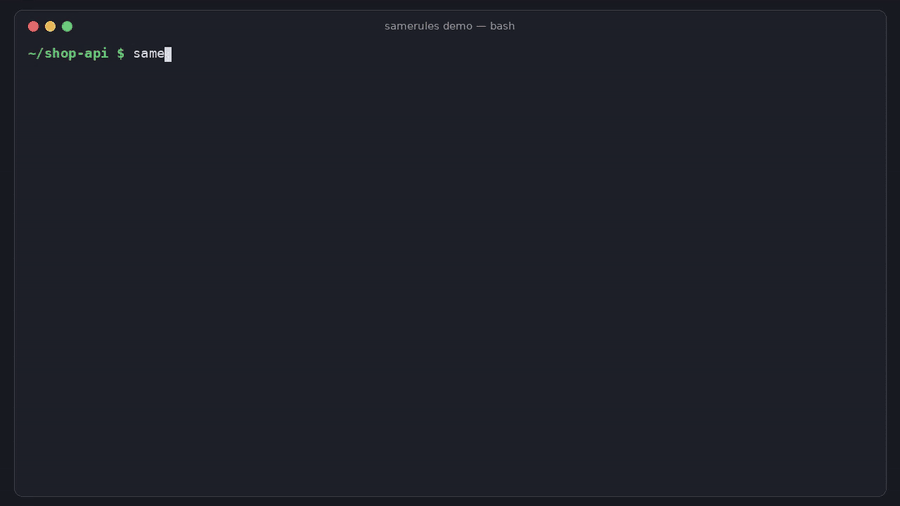

# samerules

[](https://github.com/hamarshehmhmd/samerules/actions/workflows/ci.yml)
[](LICENSE)


```bash
curl -fsSL https://raw.githubusercontent.com/hamarshehmhmd/samerules/main/install.sh | sh
```

Prefer not to pipe to sh? `pipx install git+https://github.com/hamarshehmhmd/samerules` or `uv tool install git+https://github.com/hamarshehmhmd/samerules`. [Read install.sh](install.sh) first if you like.



**One `.agents/` folder for rules, skills and MCP servers. `samerules sync` writes the native files for Claude Code, Cursor, Codex, Gemini CLI, OpenCode, Copilot and Windsurf/Devin, and `samerules check` fails CI when any of them drift.**

```console
$ echo "- Use Postgres transactions for every write." >> .agents/rules/main.md
$ samerules sync
samerules: 2 rules, 1 skill, 1 MCP server -> agents, claude, cursor, codex
  ~ AGENTS.md                        out of date: .agents/ changed since last sync
  ~ CLAUDE.md                        out of date: .agents/ changed since last sync
wrote 2, removed 0, 6 up to date

$ echo "- quick hack" >> CLAUDE.md && samerules check
  x CLAUDE.md  edited by hand since the last sync (move the change into .agents/); use --force to overwrite
1 problem(s): agent configs have drifted from .agents/ - run `samerules diff` to see them, `samerules sync` to fix
$ echo $?
1
```

## The problem

If your team uses more than one coding agent, the same instructions end up in
`CLAUDE.md`, `AGENTS.md`, `GEMINI.md`, `.cursor/rules/*.mdc`,
`.github/copilot-instructions.md` and `.windsurf/rules/`. MCP servers are copied
between `.mcp.json`, `.cursor/mcp.json`, `.vscode/mcp.json`,
`.gemini/settings.json`, `opencode.json` and `.codex/config.toml`, and each one
uses a different shape. Skills get copied into `.claude/skills` and
`.github/skills`.

Someone fixes a rule in one file and forgets the others, so Claude is told
"use pnpm" while Codex is still told "use npm". Nobody notices until an agent
does the wrong thing. People keep asking how to handle this
([Ask HN: How do you manage skills files?](https://news.ycombinator.com/item?id=49589914),
the AGENTS.md support requests with thousands of upvotes), and most answers
come down to symlinks or copying by hand.

samerules gives you one source of truth that you review like code, and a
check you can run in CI.

## Install

```bash
curl -fsSL https://raw.githubusercontent.com/hamarshehmhmd/samerules/main/install.sh | sh
```

The script uses `uv tool`, then `pipx`, then falls back to a private venv in
`~/.local/share/samerules`. You need Python 3.9+. samerules has zero dependencies.

## Usage

```bash
cd your-repo
samerules import            # build .agents/ from the CLAUDE.md, AGENTS.md, .cursor/rules, MCP configs you already have
samerules diff              # review what sync would change
samerules sync --force      # take over the existing files (only needed once, after import)
git add .agents AGENTS.md CLAUDE.md .cursor .mcp.json ...

# from now on: edit .agents/, then
samerules sync              # regenerate (refuses to clobber hand-edited files)
samerules check             # exit 1 if anything drifted -- use in CI / pre-commit
```

Starting from scratch? `samerules init` creates an empty `.agents/`.

| Command | What it does |
| --- | --- |
| `samerules sync [-n/--dry-run] [-f/--force] [-t claude,cursor]` | write every harness's native files from `.agents/` |
| `samerules check [-q]` | exit 1 if a generated file is missing, out of date, hand-edited or stale, or a skill is invalid |
| `samerules diff` | unified diff of what `sync` would change (exit 1 if there is any) |
| `samerules import [--force]` | bootstrap `.agents/` from existing files and report where they disagree |
| `samerules init [-t ...]` | create an empty `.agents/` |
| `samerules targets` | list supported agents and the files each one gets |

### The `.agents/` folder

```
.agents/
  rules/
    main.md            # always-on instructions
    api.md             # scoped rule (frontmatter below)
  skills/
    release/SKILL.md   # Agent Skills format (name + description frontmatter)
  mcp.json             # {"mcpServers": {...}} in Claude Code's format
  samerules.json       # {"targets": ["agents", "claude", "cursor", "codex"]}
  samerules.lock       # hashes of generated files - commit it
```

Rule frontmatter is optional:

```markdown
---
description: Conventions for HTTP handlers
globs: src/api/**/*.ts, src/routes/*.ts   # apply: glob is implied when globs are set
apply: glob                                 # always | glob | auto (agent decides from description) | manual
targets: [claude, cursor]                   # optional: only these harnesses
---
# API handlers
- Validate every request body with zod.
```

### What each target gets

| Target | Rules | Skills | MCP |
| --- | --- | --- | --- |
| `agents` | `AGENTS.md` | reads `.agents/skills` | |
| `claude` | `CLAUDE.md` + `.claude/rules/<rule>.md` (`paths:`) | copied to `.claude/skills/` | `.mcp.json` |
| `cursor` | `.cursor/rules/<rule>.mdc` (`globs`, `alwaysApply`, `description`) | reads `.agents/skills` | `.cursor/mcp.json` |
| `codex` | `AGENTS.md` | reads `.agents/skills` | marked `[mcp_servers.*]` block in `.codex/config.toml` |
| `gemini` | `GEMINI.md` | reads `.agents/skills` | `mcpServers` key merged into `.gemini/settings.json` |
| `opencode` | `AGENTS.md` | reads `.agents/skills` | `mcp` key merged into `opencode.json` |
| `copilot` | `.github/copilot-instructions.md` + `.github/instructions/<rule>.instructions.md` (`applyTo`) | copied to `.github/skills/` | `.vscode/mcp.json` (`servers`) |
| `windsurf` (alias `devin`) | `.windsurf/rules/<rule>.md` (`trigger`) | reads `.agents/skills` | `.devin/mcp_config.json` |

Details that matter:

- **No double loading.** Cursor and Windsurf/Devin already read `AGENTS.md`, so
  when it's generated their rule folders only get the scoped/auto/manual rules.
  Claude Code ignores `AGENTS.md` when a `CLAUDE.md` exists, so `CLAUDE.md` holds
  the always-on rules and scoped rules go to `.claude/rules/` with `paths:`.
  Single-file harnesses (`AGENTS.md`, `GEMINI.md`) get scoped rules as sections
  that say which files they apply to. Manual rules are left out of single files,
  because nobody can invoke them there.
- **Env vars are translated.** Write `${GITHUB_TOKEN}` once. Cursor and VS Code
  get `${env:GITHUB_TOKEN}`, OpenCode gets `{env:GITHUB_TOKEN}`, and Codex gets
  `env_vars = ["GITHUB_TOKEN"]` / `bearer_token_env_var`. Codex can't expand
  variables inside other values, so samerules warns you instead of quietly
  writing something broken.
- **Shared config files are merged, not replaced.** Your theme in
  `.gemini/settings.json`, your model in `opencode.json` and your other tables
  in `.codex/config.toml` are left alone. JSONC (comments) is refused rather than
  mangled.
- **Per-harness extras** go in `"overrides"` on a server, e.g.
  `"overrides": {"gemini": {"trust": true}, "codex": {"startup_timeout_sec": 20}}`.
  Use `"targets": ["claude"]` to limit a server to some harnesses.
- **Skills are validated.** A folder name that isn't lowercase-hyphen, or that
  doesn't match the `name:` in SKILL.md, can be ignored by agents without any
  error. `check` fails on it instead.

### Safety: it won't eat your edits

Every generated markdown file starts with an HTML comment saying it's
generated.
`.agents/samerules.lock` stores a hash of everything samerules wrote.
`sync` only overwrites a file if it doesn't exist, already matches, or still has
the hash samerules last wrote. A file you wrote by hand, or a generated file
someone edited, is reported as a conflict and left alone unless you pass
`--force`. Files samerules generated but no longer needs (a removed rule or
target) are deleted, but only if nobody edited them since. Symlinks are never
written through. Skills that exist only in `.claude/skills` are yours and never
touched.

### CI and pre-commit

```yaml
# .github/workflows/agents.yml
- run: pipx run --spec git+https://github.com/hamarshehmhmd/samerules samerules check
```

```yaml
# .pre-commit-config.yaml
- repo: https://github.com/hamarshehmhmd/samerules
  rev: v0.1.0
  hooks:
    - id: samerules-check     # or samerules-sync to regenerate on commit
```

## Demo

The GIF above comes from a 2-minute narrated video
([demo.mp4 on the v0.1.0 release](https://github.com/hamarshehmhmd/samerules/releases/tag/v0.1.0)),
recorded from real runs of `demo/make_repo.sh` + samerules. It shows import, sync, a source
edit that `check` catches (exit 1), and a hand edit to CLAUDE.md that `check`
and `diff` catch. Rebuild it with `python demo/render.py`.

## Limits

- Project-level files only. Global/user configs (`~/.claude`, `~/.codex`) are out of scope.
- Hooks, subagents, slash commands and permissions aren't synced (yet).
- `import` reads `.codex/config.toml` only on Python 3.11+ (stdlib `tomllib`).
- Harness formats change often. If one moved, please open an issue.

## Development

```bash
pip install -e . pytest
pytest -q
```

## License

samerules is licensed under the [GNU Affero General Public License v3.0 or later](LICENSE)
(`AGPL-3.0-or-later`).

**Commercial licensing:** if you want to embed or ship samerules without the
AGPL obligations, commercial licenses are available from the author,
Mohammad Hamarsheh ([@hamarshehmhmd](https://github.com/hamarshehmhmd)). Open an
issue or contact him via GitHub.
